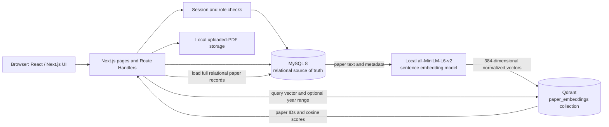

# ResearchLens
## An Intelligent Research Paper Discovery and Semantic Search System

**DBMS Experiential Learning — Level 3 Project**
**Department of Computer Science and Engineering**

| Project detail | Information |
|---|---|
| Team members | Shwetha S (PES1UG24CS452); Pratistha Majumder (PES1UG25CS831) |
| Relational database | MySQL 8 |
| Vector database | Qdrant |
| Application | Next.js 15 App Router, React 19, Next.js Route Handlers |
| Report status | Implementation and validation complete; final screenshot capture and member confirmation are still required before submission |
| Report date | 10 November 2026 |

> **Submission note:** This report describes the implementation and test evidence currently present in the project. The application, schema, and build validation were verified in the working environment. Replace the screenshot placeholders with captures from your own final demonstration, confirm the team-contribution statements with both members, and check the diagrams against the exact SQL scripts you submit.

---

## Abstract

ResearchLens is a web application for discovering and exploring research papers. A paper catalogue alone is not sufficient for discovery: students may know a topic or research question without knowing the precise words used in paper titles and abstracts. ResearchLens addresses this problem with structured relational search and semantic search.

MySQL stores users, research papers, authors, topic hierarchies, keywords, citations, search activity, saved papers, and Data Matrix records. It enforces relationships and validation rules through keys, constraints, indexes, views, stored routines, and triggers. Qdrant stores derived paper embeddings and supports cosine-similarity retrieval. The Next.js application exposes authenticated features through server-side API routes and presents paper browsing, search, semantic results, a personal library, and administration features.

The project is intended as a course prototype and demonstration of database concepts. Data Matrix summary and methodology notes are abstract-based, not verified full-text extractions. A separate optional demo seed supplies synthetic sample-size/limitations examples for five papers; those assumptions are labeled as synthetic demo values, not paper-reported findings. Demo consensus claims also remain labeled as demo data.

## 1. Problem Statement

Students and researchers often need to find papers relevant to an idea before they know the exact title, author, or keywords. Exact-word search is useful, but it can miss papers that describe the same concept with different terminology. A useful discovery system should also organize papers consistently, expose citations and topic relationships, and let users retain papers and searches for later.

ResearchLens combines:

1. Relational search over normalized paper metadata and research taxonomies.
2. Meaning-based retrieval over paper text using vector embeddings.
3. User-facing tools for saved searches, saved papers, paper management, and research-matrix exploration.

## 2. Objectives

- Design a normalized relational schema for papers and their many-to-many relationships with authors, topics, and keywords.
- Apply primary keys, foreign keys, uniqueness, checks, indexes, and database triggers to protect data integrity.
- Demonstrate SQL DDL and DML, including joins, aggregates, correlated subqueries, views, a stored procedure, a stored function, and transactions.
- Build a functional Next.js interface integrated with MySQL and Qdrant.
- Implement keyword, title, author, and semantic paper discovery.
- Provide role-based access for students and administrators.
- Demonstrate why a relational database and a vector database are both appropriate to this application.

## 3. Functional Requirements

### 3.1 Student

- Register and sign in.
- Browse papers and view abstracts, authors, topics, keywords, citations, and PDF links.
- Search by keyword, title, or author and filter by topic/domain/year.
- Search by meaning using a natural-language query.
- View similar and recommended papers.
- Save and remove papers from a personal library.
- View, save, rerun, and remove personal searches.
- Browse and query the Data Matrix.

### 3.2 Administrator

- Add, edit, and delete papers.
- Upload PDFs for authenticated use.
- Manage user roles.
- Rebuild the Qdrant paper index.
- View the paper audit log.

Authorization is checked on the server. A user's role is read from MySQL, rather than trusted solely from the session token.

## 4. System Architecture



MySQL is authoritative for paper metadata and relationships. Qdrant stores derived vectors and a compact metadata payload for retrieval. Search results from Qdrant are joined back to MySQL so the application can display the relational record. Uploaded PDFs are kept in local storage and are not stored in Git.

## 5. Database Selection and Justification

### 5.1 MySQL

MySQL is appropriate for structured records with clear relationships and integrity requirements: users, papers, authors, research topics, keywords, citations, and saved items. Foreign keys and transactions ensure that linked records are not left partially written. It also supplies full-text search, aggregate queries, views, triggers, and stored routines required for the project.

### 5.2 Qdrant

Paper titles, abstracts, keywords, and topics contain text whose meaning may not be captured by exact keyword matching. Qdrant is used for nearest-neighbour search over dense embeddings. It complements rather than replaces MySQL: MySQL stores canonical records, while Qdrant stores derived search vectors.

### 5.3 Vector Model and Retrieval

- **Embedded content:** title, abstract, keyword labels, and topic labels.
- **Model:** `Xenova/all-MiniLM-L6-v2`, through `@huggingface/transformers` / Transformers.js, run locally.
- **Output:** 384-dimensional vectors, mean pooled and L2-normalized.
- **Collection:** `paper_embeddings`.
- **Point identifier:** MySQL `paper_id`.
- **Similarity:** cosine distance/similarity configured in Qdrant.
- **Payload:** paper ID, title, publication year, journal, topics, and domains. Year-range filters are applied to this payload.
- **Retrieval:** embed the query, retrieve the nearest vectors, enforce a minimum score of 0.35 for semantic search, and fetch full result records from MySQL. The similar-paper feature excludes the source paper.
- **Synchronization:** paper create/edit operations index the paper; delete operations remove its vector. An administrator can rebuild the collection from MySQL.

## 6. ER Diagram and Relational Schema

These deliverables describe the **SQL tables only**, not the whole application:

- [Chen-notation ER diagram](./researchlens_chen_er.svg)
- [Relational schema diagram](./researchlens_relational_schema.svg)

The Chen diagram uses entity rectangles, attribute ovals, relationship diamonds, and cardinalities. The relational schema diagram shows columns and key constraints. Qdrant is documented separately in Section 5.

### 6.1 Relational Entity Groups

| Group | Tables | Purpose |
|---|---|---|
| Users and activity | `users`, `saved_search`, `search_history`, `saved_paper` | Authentication identities, search history, saved queries, and reading lists |
| Research hierarchy | `research_domain`, `research_subdomain`, `research_topic` | Hierarchical classification of research subjects |
| Paper catalogue | `research_paper`, `author`, `keyword`, `citation` | Core paper metadata and citation relationships |
| Many-to-many links | `paper_author`, `paper_topic`, `paper_keyword` | Normalize paper relationships; preserve author order |
| Data Matrix | `paper_extraction`, `matrix_claim`, `matrix_claim_stance` | Store extraction fields and claim stances; demo rows are labelled |
| Audit | `paper_audit_log` | Preserve paper INSERT/UPDATE/DELETE events written by triggers |

### 6.2 Data Dictionary Summary

| Table | Primary key | Foreign keys / important constraints | Main role |
|---|---|---|---|
| `users` | `user_id` | Unique email; role and email checks | Student/admin accounts |
| `research_domain` | `domain_id` | Unique domain name | Top-level research area |
| `research_subdomain` | `subdomain_id` | `domain_id` → domain; unique `(domain_id, subdomain_name)` | Second taxonomy level |
| `research_topic` | `topic_id` | `subdomain_id` → subdomain; unique `(subdomain_id, topic_name)` | Topic-level classification |
| `research_paper` | `paper_id` | Unique DOI; publication-year check | Paper metadata and PDF URL |
| `paper_topic` | `(paper_id, topic_id)` | Both columns reference their parent tables; cascade delete | Paper-topic M:N link |
| `author` | `author_id` | — | Author names and optional details |
| `paper_author` | `(paper_id, author_id)` | Both columns reference parents; positive author order check | Paper-author M:N link |
| `keyword` | `keyword_id` | Unique keyword | Search terms |
| `paper_keyword` | `(paper_id, keyword_id)` | Both columns reference parents; cascade delete | Paper-keyword M:N link |
| `citation` | `(citing_paper_id, cited_paper_id)` | Both reference `research_paper`; self-citation check | Directed citation and optional context |
| `saved_search` | `search_id` | `user_id` → `users` | User's saved search query |
| `search_history` | `history_id` | `user_id` → `users`; non-negative result count | Search activity |
| `saved_paper` | `saved_paper_id` | User and paper FKs; unique `(user_id, paper_id)` | Personal reading list |
| `paper_audit_log` | `log_id` | `paper_id` intentionally has no FK to preserve deleted-paper history; action check | Trigger-maintained audit trail |
| `paper_extraction` | `(paper_id, field_key)` | `paper_id` → paper; field/origin/confidence checks | Data Matrix fields and source metadata |
| `matrix_claim` | `claim_id` | Unique claim text; source/demo basis check | Matrix claim |
| `matrix_claim_stance` | `(claim_id, paper_id)` | Claim and paper FKs; stance check | Claim stance per paper |

The SQL scripts also define indexes, a FULLTEXT index, three views, six triggers, and two routines. The exact column definitions and constraints are in `sql/01_schema.sql`, `sql/04_member2_advanced.sql`, and `sql/04b_extractions.sql`.

## 7. SQL Implementation

### 7.1 DDL and Integrity

The numbered scripts demonstrate `CREATE DATABASE`, `CREATE TABLE`, indexes, views, stored routines, and triggers. `sql/05_validation_and_negative_tests.sql` contains demonstrations for `ALTER`, `DROP`, and statements expected to fail. The clean-install script `sql/01_schema.sql` starts with `DROP DATABASE IF EXISTS`; **do not run it on a database whose data must be retained**.

Integrity features include:

- Primary and foreign keys, with cascade behaviour on dependent rows where appropriate.
- Unique constraints on account email, DOI, taxonomy names, keywords, and a user's saved paper.
- `NOT NULL` and `CHECK` constraints for roles, years, citation self-links, search result counts, and matrix fields.
- Triggers to normalize and validate paper titles, DOI, journal, PDF URLs, and search-history text.
- An audit trail for paper inserts, updates, and deletes.
- A FULLTEXT index on paper title and abstract; additional B-tree indexes for common filters and lookup keys.

### 7.2 DML and Query Coverage

The SQL demonstration scripts and application routes cover `INSERT`, `UPDATE`, `DELETE`, and `SELECT`. The query examples include multi-table joins, the full research hierarchy, `GROUP BY`, `HAVING`, `ORDER BY`, aggregate functions, `EXPLAIN`, full-text search, and subqueries.

### 7.3 Correlated Query Example

The following query is in `sql/02_sample_data_and_queries.sql`. The subquery is correlated because it refers to `p.paper_id` from the outer query:

```sql
SELECT p.title
FROM research_paper AS p
WHERE NOT EXISTS (
    SELECT 1
    FROM citation AS c
    WHERE c.cited_paper_id = p.paper_id
);
```

For each outer paper `p`, the inner query checks whether a citation points to that paper. `NOT EXISTS` keeps papers for which no such citation exists. The `v_paper_details` view in `sql/04_member2_advanced.sql` also uses correlated subqueries to collect authors, topics, domains, keywords, and citation counts per paper without multiplying rows across joined link tables.

### 7.4 Advanced Database Concepts

| Concept | Implementation |
|---|---|
| Transaction | `sp_add_paper` commits all linked inserts or rolls them back on an SQL exception; application add/edit flows also use transactions |
| Stored procedure | `sp_add_paper` inserts a paper and its topic/author links |
| Stored function | `fn_citation_count(paper_id)` returns inbound citation count |
| Full-text search | `ft_paper_title_abstract` and `MATCH ... AGAINST` |
| Triggers | Validation/normalization and paper audit logging |
| Views | `v_paper_details`, `v_topic_statistics`, `v_user_search_activity` |
| Vector similarity | Qdrant cosine nearest-neighbour search over paper embeddings |

This exceeds the course minimum of four advanced SQL concepts plus one NoSQL/vector feature.

## 8. Application and Database Integration

The Next.js App Router provides server-rendered pages and API Route Handlers. Database access is centralized through a MySQL connection pool in `lib/db.js`; routes call shared domain helpers in `lib/`. Database settings and the JWT signing secret are read from environment variables, with `.env.example` provided as a template. `.env.local` is local-only and must not be committed.

Student and administrator permissions are enforced server-side. Paper mutations are restricted to administrators. Search, saved-item, and history operations are scoped to the logged-in user. Uploaded PDFs are served through authenticated routes.

## 9. Important Application Features

- Browse and inspect papers, authors, topic hierarchies, keywords, and citations.
- Add, edit, delete, and upload paper PDFs (administrator).
- Search by keyword, title, or author with domain/topic/year filters.
- Semantic search and similar-paper discovery through Qdrant.
- Save, rerun, and delete personal searches.
- Save papers to a personal library.
- Recommend papers sharing authors or topics.
- Explore the Data Matrix, filter/export data, and ask questions against stored extraction fields.
- View user/activity information and paper audit records through administrative features.

## 10. Testing and Results

### 10.1 Recorded Automated Evidence

`docs/TESTING.md` records **57 passing API/end-to-end checks and 0 failures**, plus page-protection checks and SQL negative-test cases. Its own notes state that the test environment used a MySQL-compatible Dolt server and stand-ins for some packages and for the embedding model; therefore its semantic cosine values are not the real model's results. Treat it as existing test evidence, not as a substitute for the final demonstration on the actual environment.

### 10.2 Environment Checks During Report Preparation

On 10 November 2026, the project health check reported MySQL 8.0.46, 18 tables, 3 views, 6 triggers, 2 routines, 17 papers, Qdrant with 17 vectors, 384 dimensions, and cosine distance. The production build completed successfully and the app served successfully on `http://localhost:3000` with HTTP 200. These are environment-specific observations, not fixed properties of every installation.

The matrix coverage refresh creates four explicit field rows for each of the 17 catalog papers. Summary and methodology rows are labeled as abstract-based; sample-size and limitations rows are labeled as unavailable from the stored abstracts and require full-text review. These coverage rows do not claim that those latter fields were extracted from the papers.

### 10.3 Required Final Manual Test

Before submitting, run the app from a cleanly configured environment and record the actual results:

1. Register a student and log in; verify unauthorized users are redirected or rejected.
2. Browse a paper and verify DOI/PDF links and citation navigation.
3. Exercise keyword, title, author, domain/topic/year-filtered search.
4. Save a search, rerun it from history, then remove it.
5. Save a paper to My Library, refresh, and remove it.
6. Run semantic search and a similar-paper query; verify Qdrant status and paper/vector counts.
7. As an administrator, add/edit/delete a paper and verify audit records and vector synchronization.
8. Run the correlated SQL example and capture its output.
9. Run relevant negative tests and record the expected database rejections.

Record date, MySQL/Qdrant versions, result, and any issue in the submitted report after testing.

## 11. Screenshots for Final Submission

Screenshots are intentionally not fabricated. Capture these from the running application and replace each placeholder with an actual image or insert it in the final Word/PDF report:

| Figure | Capture to add |
|---|---|
| 1 | Login/register and signed-in navigation |
| 2 | Paper catalogue and a paper-detail page |
| 3 | Filtered keyword search results |
| 4 | Semantic query and ranked results |
| 5 | Saved-paper button and populated My Library |
| 6 | Administrator paper form and audit log |
| 7 | Data Matrix and its filters/export or question panel |
| 8 | MySQL Workbench/terminal showing the correlated query and output |
| 9 | Successful `npm run check-setup` output and Qdrant status |

Keep personal information, credentials, cookies, and `.env.local` values out of screenshots.

## 12. Team Responsibilities and Contributions

The SQL filenames identify Member 1's procedure/function/full-text work and Member 2's trigger/view work. This is a starting point only; confirm and replace it with each member's actual implementation and application contributions before submission. The course requires each member to contribute to both database and application development.

| Member | Database contribution | Application contribution | Evidence to confirm |
|---|---|---|---|
| Shwetha S | Designed and implemented the normalized MySQL schema, paper/author/topic/keyword relationships, full-text search configuration, stored procedure `sp_add_paper`, stored function `fn_citation_count`, and database-side query logic in `sql/01_schema.sql`, `sql/02_sample_data_and_queries.sql`, and `sql/03_member1_advanced.sql`. | Built the paper catalogue workflow, admin add/edit/delete operations, upload-aware paper management flow, and related paper browsing UI/backend integration across the app, including the paper detail and admin pages. | Commit history, SQL script ownership, file-level implementation in `sql/` and `app/` routes/pages, and final demo walkthrough. |
| Pratistha Majumder | Implemented the database validation layer with triggers, audit trail, and views in `sql/04_member2_advanced.sql`, including constraints, data-cleaning checks, and reporting views for paper/user activity. | Built authentication, role enforcement, saved searches/library, semantic search/Qdrant integration, Data Matrix features, and the user-facing search and history experience across `lib/auth.js`, `lib/vector.js`, `lib/matrix.js`, and the app pages/routes. | Commit history, SQL trigger/view ownership, app route and component implementation, and final demo walkthrough. |

Also confirm instructor approval of the two-member team and uniqueness of the project title within the section.

## 13. Limitations and Future Work

- The Data Matrix does not yet contain verified full-text sample-size or limitations extractions. Its abstract-derived notes and unavailable markers must not be presented as full-text review; complete those fields from the cited papers before drawing research conclusions. Consensus claims remain explicitly labelled demo data.
- The optional `sql/12_matrix_synthetic_demo_values.sql` deliberately uses assumed values for interface demonstrations only. Those synthetic values must not be represented as actual study characteristics or used in the submitted research analysis.
- Vector ranking quality depends on embedding coverage and the selected sentence-transformer model.
- Uploaded PDFs are stored on the application host's local disk; production deployment would need durable shared object storage and a backup/retention policy.
- The project is a course prototype, not a production-scale scholarly index. Production use would require stronger operational monitoring, backup, rate limiting, deployment hardening, and larger verified bibliographic coverage.
- Potential future improvements include user notes/collections, citation graph visualization, external metadata import, and alerts for new papers matching saved searches.

## 14. Conclusion

ResearchLens demonstrates a connected database application rather than a basic CRUD interface. MySQL provides normalized structured data, referential integrity, transactional writes, full-text search, advanced SQL routines, views, and triggers. Qdrant adds vector similarity search for concept-level discovery over text. A Next.js application integrates both databases through server-side APIs and provides student and administrator workflows.

The implementation provides a strong basis for the DBMS Level 3 evaluation. Final submission readiness depends on completing the actual-environment manual test, inserting real screenshots, verifying both SQL-only diagrams against the final scripts, and confirming team contributions and course approvals.

## Appendix A — Setup Summary

From the project directory, create `.env.local` from `.env.example`, set a local database password and a random JWT secret, and start the services:

```powershell
docker compose --env-file .env.local up -d
npm install
npm run check-setup
npm run index-papers
npm run dev
```

Open `http://localhost:3000`. Follow the README for administrator setup. Do not commit `.env.local`. For an existing database missing the personal-library table, run `sql/10_saved_paper_library.sql`; do not rerun `sql/01_schema.sql` on data that must be retained because it drops and recreates the database.

## Appendix B — Project References

- Application setup and API details: [`README.md`](../README.md)
- SQL scripts: [`sql/`](../sql/)
- Chen ER diagram: [`researchlens_chen_er.svg`](./researchlens_chen_er.svg)
- Relational schema: [`researchlens_relational_schema.svg`](./researchlens_relational_schema.svg)
- Existing testing notes: [`TESTING.md`](./TESTING.md)
